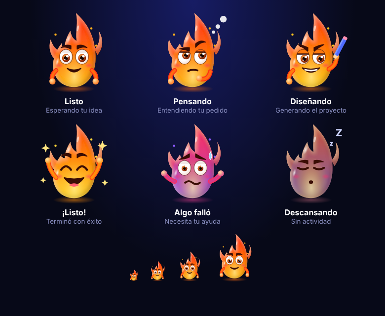

<p align="center"></p>

# Ignis Studio

Agente de diseño con modelos locales — app Android construida a partir del diseño **Ignis Studio**.

La app usa exactamente el HTML, CSS y JS del diseño original (`app/src/main/assets/index.html`), mostrado a pantalla completa dentro de un WebView nativo, una pantalla a la vez.

## Pantallas
1. Pantalla de inicio · 2. Chat / Agente · 3. Modelos GGUF · 4. Proyecto Plantillas · 5. Resultado / Vista previa · 6. Skill Store · 7. MCP / Herramientas · 8. Biblioteca de Diseños · 9. Ajustes / Sistema · 10. Generar APK

## Funciones (las del diseño)
- Barra inferior: Inicio, Chat, Crear, Biblioteca, Ajustes; botón ← de cada pantalla y botón atrás de Android.
- Chat con atajos (Diseño Web, App Android, UI/UX, Recrear, Mejorar, Generar Código), envío con Enter y chip del modelo activo.
- Modelos: pestañas Todos / Cargados / Recom. / Nube, descargar → cargar modelo, conexión a proveedores en la nube.
- Plantillas con búsqueda y filtros; Resultado con Vista / Código / Archivos, Exportar ZIP y Abrir en navegador.
- Skill Store y MCP: instalar / desinstalar, filtros por pestaña.
- Biblioteca con filtros; Ajustes con selector de avatar (20 orbes) y animación on/off.
- Generar APK con los 5 pasos animados.
- “Toca un logo para ponerle el oficial”: abre la galería del teléfono y guarda el logo (localStorage).

> Las acciones que en el diseño son simuladas (descarga de modelos, respuesta del agente, exportar ZIP, compilar APK) siguen siendo simuladas: no se añadió lógica que el diseño no tenía.

## Ignis, el avatar del agente
Personaje llama que cambia según lo que hace el agente:

<p align="center"></p>

| Estado | Cuándo aparece |
|---|---|
| Listo | En espera |
| Pensando | Al enviar un pedido en el Chat |
| Diseñando | Generando, descargando un modelo o compilando la APK |
| ¡Listo! | Al terminar cualquiera de esas tareas |
| Algo falló | Al intentar un modelo no compatible |
| Descansando | Tras 1 minuto sin actividad; se despierta al tocar la pantalla |

Se ve en Inicio, en el Chat y en **Ajustes ▸ Avatar del agente**, donde se pueden previsualizar los estados.

## Navegación
- Barra inferior flotante con burbuja violeta que se desliza a la pestaña activa.
- **Vibración** al tocar (nativa en Android, respeta los ajustes del teléfono).
- **Desliza a los lados** para cambiar de pestaña.
- La barra **se oculta al bajar** y vuelve al subir.
- **Aviso naranja** en Chat cuando Ignis termina mientras estás en otra pantalla.
- **Mantén pulsado Crear** para un menú rápido: Diseño Web, App Android, UI/UX o plantillas.
- **Pantalla de bienvenida** con la llama del logo (SplashScreen de Android 12+, compatible desde Android 8).

## Compatibilidad de modelos
La app lee el teléfono real (RAM total y libre, espacio libre, chip, núcleos y arquitectura) y marca cada modelo:

| Etiqueta | Regla |
|---|---|
| Compatible | peso del modelo + 1 GB ≤ 60 % de la RAM |
| Justo · contexto reducido | ≤ 70 % de la RAM |
| No compatible | más que eso, o procesador sin 64 bits (no se deja descargar) |

La pestaña **Recom.** solo muestra los modelos compatibles con holgura. En la vista previa web se puede simular la RAM (4–16 GB).

## Cerebro del agente
Memoria del proyecto que no depende del modelo: guarda tus pedidos, los cambios de modelo y el historial del chat. Al cambiar de modelo, el agente sigue donde lo dejaste.
- En Android se guarda en `cerebro.json` dentro de la app (y en el almacenamiento del WebView).
- Se ve y se borra en **Ajustes ▸ Cerebro del agente**; en el Chat aparece el contador de recuerdos.

## Compilar la APK

### Con GitHub Actions (sin instalar nada)
1. Sube esta carpeta a un repositorio nuevo en GitHub (rama `main`).
2. Ve a la pestaña **Actions** → **Compilar APK** (se ejecuta solo en cada push, o pulsa *Run workflow*).
3. Al terminar, descarga el artefacto **IgnisStudio-apk** con `app-debug.apk` y `app-release.apk`.

### En tu PC
Abre la carpeta en Android Studio (Hedgehog o superior) y pulsa *Build ▸ Build APK(s)*, o con Gradle 8.9 y JDK 17:

```bash
gradle assembleDebug
```

## Estructura
```
app/src/main/assets/index.html      # Diseño original + modo app (una pantalla a la vez)
app/src/main/java/com/ignis/studio/MainActivity.kt   # WebView, selector de imágenes, botón atrás
app/src/main/java/com/ignis/studio/DeviceBridge.kt   # Lee RAM, espacio, chip y arquitectura
app/src/main/java/com/ignis/studio/BrainBridge.kt    # Guarda el cerebro en cerebro.json
app/src/main/java/com/ignis/studio/HapticBridge.kt   # Vibración al tocar
app/src/main/res/                   # Tema oscuro, icono con el orbe Eclipse
.github/workflows/build-apk.yml     # Compilación automática
```
